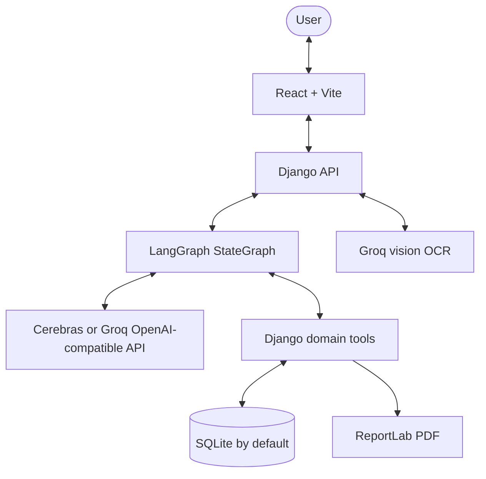

# Technical Architecture

## System overview

The application uses a React/Vite client, a Django API, and a Python LangGraph agent. Django owns authentication, relational persistence, domain tools, OCR integration, and generated PDFs.

## Components

### Frontend

- `frontend/src/main.tsx` mounts the React application.
- `frontend/src/app/react-home.tsx` contains the loan assistant chat interface.
- `frontend/src/components/react-login-signup.tsx` handles login and signup.
- `frontend/src/api.ts` sends credentialed requests and the Django CSRF token.
- Vite serves the frontend on port 5173 by default from the `frontend/` root.

### Django backend

- `backend/config/` configures Django, CORS, routes, and media serving.
- `backend/loans/models.py` defines users, loan products, KYC and credit records, and persistent chat sessions.
- `backend/loans/views.py` provides authentication, chat, and OCR endpoints.
- `backend/loans/agents/graph.py` defines the LangGraph state graph and its tool loop.
- `backend/loans/migrations/` contains the initial relational schema.

### LangGraph agent

The graph carries the conversation as message state. Its agent node calls a configurable OpenAI-compatible chat model and routes requested tools to a sequential tool node. The tools use Django ORM records and save workflow changes to the applicant's chat session. The six tools replace the former Mastra tools: `updateProfile`, `verifyKYC`, `getCreditScore`, `calculateFOIR`, `getAvailableLoans`, and `generateLoanPDF`.

Provider setup uses `LLM_API_KEY`, `LLM_BASE_URL`, and `LLM_MODEL`. If the generic key is absent, the backend detects `CEREBRAS_API_KEY` or `GROQ_API_KEY` and selects provider defaults.

### Persistence and documents

SQLite is the development default. KYC, credit, and loan data are maintained through Django admin or imported fixtures. Chat history and stage state are stored in `ChatSession`; sensitive Aadhaar and PAN values are redacted from stored message logs. OCR uses the Groq vision API, and loan confirmation PDFs use ReportLab.

## Authentication and security

Django session cookies and CSRF protection replace the former JWT cookie. The React client includes credentials and the CSRF token for state-changing calls. Configure a strong `DJANGO_SECRET_KEY`, production hosts, HTTPS, and secure cookie settings before deployment.
