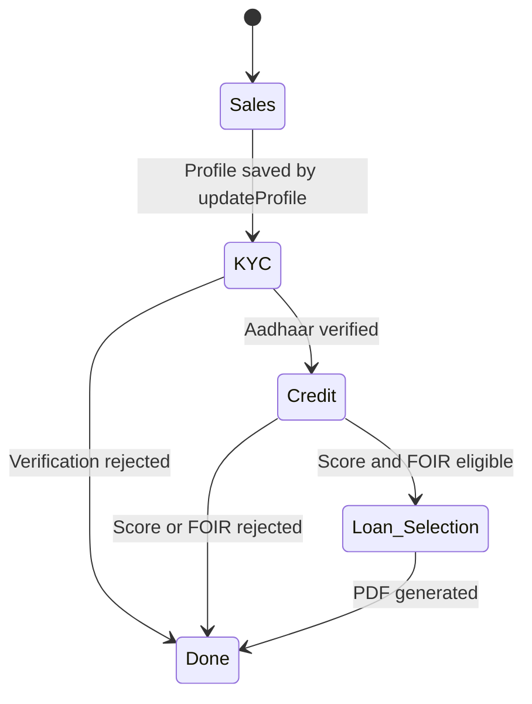
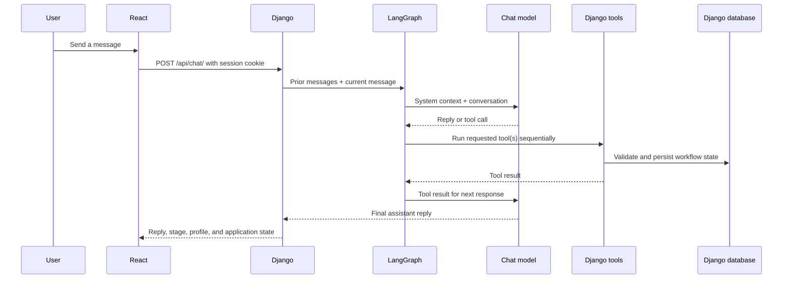

# Data Flow & Workflow

## Loan application workflow

The LangGraph agent decides when to call tools. Django tools validate each transition against stored session state and database records. The API persists user and assistant messages while redacting Aadhaar and PAN from stored logs.

## Chat and tool flow

## Document OCR

The React client uploads a JPEG, PNG, or WebP image to `POST /api/ocr/upload/`. Django validates its type and size, sends the image to Groq Vision, and returns extracted fields to the chat client. The chat agent can then use `updateProfile` or the KYC and credit tools as appropriate.

## Loan PDF

After a verified applicant passes credit and FOIR checks, `getAvailableLoans` returns products from Django's database. Once the applicant chooses one, `generateLoanPDF` confirms the selected product against the options previously returned, creates a PDF under Django media storage, and adds the download path to the session response.
